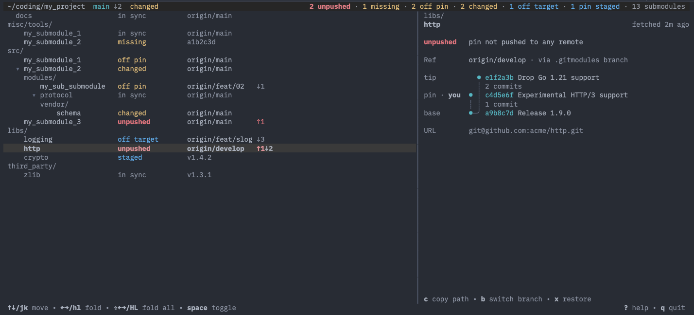

# submarine

**A terminal UI for git repositories with many submodules.**
See what needs your attention. Ignore the rest.

`git submodule status` gives you a wall of commit hashes. submarine answers
the questions you actually have:

- Which branch is this submodule on, and is the pin current?
- Which submodules need me, and which are fine?
- Is anything dangerous, like a pin nobody else can fetch?



## Why you might like it

- **Only submodules, as a tree.** Nested submodules at any depth, grouped by
  directory, collapsed until you open them.
- **Branch plus distance, not hashes.** `origin/main ↓2` says more than
  `b7c8d9e`. A pin on a feature branch shows that branch.
- **Problems are loud, healthy is quiet.** Submodules without issues are
  muted `in sync`; a staged pin shows as blue `staged` (or a `●` after an
  issue word). A collapsed parent counts the problems hidden below it
  (`·1`) and shows `●` if a staged pin is hidden.
- **Words, not symbols.** Every state is a short word (`unpushed`, `conflict`,
  `missing`, `off pin`, `changed`, `off target`), so nothing depends on color
  alone.
- **Live.** Follows changes you make in other shells within about two
  seconds. It never fetches on its own: the detail pane shows when a
  repository was last fetched, `f` fetches everything.
- **Fix it from the same screen.** Restore a repository to exactly what git
  records (`x`), switch it to another branch (`b`), move a pin that is
  behind to the tip of its branch (`u`), or resolve a pin conflict during a
  merge (`m`). They ask first if work would be lost.
- **Built for dozens to hundreds of submodules.** Each status loads
  asynchronously, so the UI never freezes.

## Install

```sh
curl -fsSL https://raw.githubusercontent.com/simonfranken/submarine/main/install.sh | sh
```

Installs `sub` and `submarine` (linux/macOS, amd64/arm64) to `~/.local/bin`.
Both names start the same program; the examples below use the shorter `sub`.
Update later with `sub update`.

## Try it

```sh
sub                  # the repository in the current directory
sub ~/code/project   # any directory inside a repository
sub --mock           # built-in sample data, no repository needed
```

`submarine` works everywhere `sub` does, e.g. `submarine --mock`.

## Examples

### Find what needs attention

Problems stand out: `unpushed` in red, `off pin` and `changed` in yellow,
`off target` (the pin is not on the branch it should be, usually `main`) in
blue, everything else muted. Select a submodule to see the details on the right:
every issue in words, the resolved ref and why, where the pin, the tip and
your checkout are in the history, and a preview of uncommitted changes.

```
 src/                                    │ src/
     core        off pin   origin/main   │ net
   ▸ net [2]     unpushed  origin/main ↑1│
     ui          in sync   origin/main   │ unpushed  pin not pushed to any remote
                                         │
                                         │ Ref       origin/main · via checked out branch
                                         │ pin · you ● b7c8d9e Hotfix null pointer
                                         │           ┊ 1 commit
                                         │ tip       ● 6f5e4d3 Release 2.1.0
```

### Jump to a submodule with `/`

Press `/` and type. Only matching submodules (and the parents that lead to
them) stay. Your selection moves to the next match if it was filtered out.

```
 libs/
   ▾ log          in sync   origin/main
     modules/
         nested   changed   origin/main
 / nest                                          enter navigate • esc close
```

`enter` keeps the filter and gives you the normal keys back, `esc` removes
it and leaves your selection where it is.

### Copy a path

Select a submodule and press `c`. Its absolute directory lands in your
clipboard, ready for `cd <paste>`. It works over SSH too (OSC 52; in tmux,
`set -g set-clipboard on`).

### Restore with `x`

Select a submodule (or the header for the whole superproject) and press `x`.
Its worktree becomes exactly what git records, and so do all submodules
below it: changes are reset, untracked files removed, merges and rebases
ended, missing submodules cloned. Staged pins are kept. A submodule whose pin
is a branch tip ends on that branch instead of a detached HEAD (a missing
local branch is created from the remote one; no branch is ever moved). If
something would be lost, you are asked first:

```
 Restore src/app? Discards 7 changed files in 3 repositories.      y restore · n cancel
```

`y` restores, any other key cancels. Without a loss it runs at once. For a
submodule with a staged pin, `x` first asks whether to restore to the staged
pin (`s`) or the committed one (`c`, which unstages it).

`X` restores to the committed pins without asking which one, and also
drops the staged pins of submodules below the selection, which `x` keeps
where it can. It asks if work or a staged pin would be lost.

### Switch a branch with `b`

Press `b` on a submodule (or the header for the superproject). A popup lists
the local and remote branches, newest first; type to filter.

```
 ╭──────────────────────────────────────────────────────────╮
 │ Switch libs/feature                                      │
 │ / sea                                                    │
 │ ──────────────────────────────────────────────────────── │
 │   origin/feat/search                    58a2bf1  2h ago  │
 │ ↑↓ select · enter switch · esc cancel                    │
 ╰──────────────────────────────────────────────────────────╯
```

`↑` `↓` select, `enter` switches, `esc` cancels. The tip of the branch
becomes the submodule's staged pin and it is restored to it, with HEAD on the
branch. Picking `origin/feat` creates a local `feat` that tracks it. Like restore, it asks
first if work would be lost. The list is read from disk, so press `f` first
to see new remote branches.

An existing local branch that is only behind the remote branch is
fast-forwarded; one with commits of its own is never moved.

### Update a pin with `u`

On a submodule whose pin is behind its branch (`origin/main ↓2`), `u` moves
the pin to that branch's tip: the same as picking `origin/main` with `b`,
without the popup. On the header it fast-forwards the superproject's branch
to its upstream (`main ↓1`), like `git pull --ff-only`, and restores the
submodules. It takes exactly the commits shown and fetches nothing; press
`f` first to see newer ones.

### Fetch and reload

`f` fetches all repositories again, `r` reloads everything after you edited
files.

## Keys

| Key | Action |
|---|---|
| `↑` `↓` / `j` `k` | Move |
| `←` `→` / `h` `l` | Fold / unfold, parent / first child |
| `H` `L` / `⇧←` `⇧→` | Collapse / expand all |
| `space` | Toggle the selected submodule |
| `home` `end` / `g` `G`, `pgup` `pgdn` | Jump, page |
| `!` | Problems only |
| `/` | Filter |
| `c` | Copy path |
| `u` | Update: move a pin that is behind to the tip of its branch (staged, like `b`); on the header, fast-forward the superproject |
| `b` | Switch branch: pick a local or remote branch; its tip is staged and the repository restored to it |
| `x` | Restore to pin: make the worktree exactly what git records (asks if work would be lost) |
| `X` | Restore committed pins: like `x`, but dropping all staged pins below (asks first) |
| `m` | Resolve pin conflict: pick ours, theirs or a commit with both; it is staged and the repository restored to it |
| `f` / `r` | Fetch / reload |
| `?` | Full help: every key, then what the words and symbols mean (`esc` closes it) |
| `q` | Quit. If a newer release exists, the footer offers `q quit and update to vX` (highlighted) and plain quit moves to `Q` |

The mouse works too: click to select, click `▸` to toggle, wheel to move. In
the branch popup, click a branch to switch to it, use the wheel to move, and
click outside to close it.

## Status

A prototype. Browsing is complete. Four write actions exist: restore (`x`),
switch branch (`b`), update pin (`u`) and resolve pin conflict (`m`), see
[docs/actions.md](docs/actions.md).

## Documentation

Requirements, state rules, UX guide, architecture and the decision log are in
[docs/](docs/README.md).

## Development

```sh
go run ./cmd/submarine --mock   # run on mock data
scripts/make-fixture.sh DIR     # build a test superproject with every state
go vet ./... && go test ./...
```
